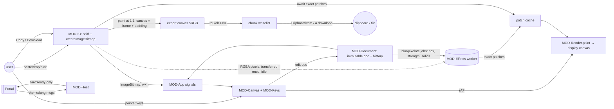

# Architecture proposal — Image Annotator (phase 3, for stack approval)

Date 2026-10-27, updated 2026-11-02 after design (G2, D-014…D-021) · Status: **proposal**. Nothing is written under `specs/40-technical/` until the owner approves the stack.
Inputs: specs (ready), D-001…D-010, D-011/D-012 (style), siblings `json-formatter` and `data-analysts-file-viewer` (DAFV, newest conventions).
Evidence: a 10-minute probe run in the sibling's Playwright (Chromium 153, WebKit 26.6; Firefox does not launch on this machine, ADR-0015 of JF / ADR-0014 of DAFV). The results are marked **[probe]**.

## Summary
A static single-page tool, built like its siblings: **Preact 10 + @preact/signals, TypeScript 6, Vite 8, pnpm, Vitest + fast-check, Playwright (Chromium + WebKit), axe, Lighthouse CI, Cloudflare static assets, a strict CSP (`connect-src 'none'`), a hand-written offline service worker, generated tokens, copy and headers, no CI**. What is new is all our own code with **no new runtime dependency**. It covers: a **hand-rolled Canvas 2D scene renderer**, with one paint function for both screen and export; **`createImageBitmap` decoding** into sRGB; a **deterministic integer blur and pixelate** that we define and run in a worker; **`canvas.toBlob` PNG followed by a chunk whitelist**, because WebKit adds `sRGB` and `eXIf` chunks **[probe]**; `ClipboardItem` with a promised blob; and **snapshot undo** over an immutable document. The typeface is Manrope 600, already in the suite, with the Latin and Vietnamese subsets.

## Assumptions
- A1 "50 MB" = 50,000,000 bytes (suite convention, DAFV A6).
- A2 The portal applies the frame-grant change request (D-006): `sandbox` gets `allow-downloads allow-modals`, plus `allow-popups allow-popups-to-escape-sandbox` (optional); `allow="clipboard-write"`; `iframe.focus()` runs on ready. Until it does, the spec fallbacks apply.
- A3 Production address `https://image-annotator.tarokit.app`; embedded by `https://tarokit.app`.
- A4 Text line height = 1.25 × text size, and canvas text weight 600: confirmed by the approved designs (D2/D3 boards draw text at 1.25×).
- A5 At zoom levels of 200 % and above, the image is drawn without smoothing so pixel edges are crisp for precise redaction. This affects the view only (INV-05).

---
## 1. Stack

### Reused verbatim from the siblings (same ADR text, renumbered)
Dependency/licence policy (ADR-0001: MIT/ISC/BSD/0BSD/Apache-2.0/OFL; MPL/LGPL allowed for dev only). Preact + signals. TS strict + Vite + pnpm + ESLint, with the network/storage API ban and import-boundary rules. Plain CSS from DTCG tokens via style-dictionary. lucide-static icons, inlined (ISC, which ADR-0001 allows). Copy catalog generated from `copy.md` with en-US + vi-VN and `Intl.NumberFormat`/`Intl.PluralRules` (DAFV ADR-0015). Host contract: `taro:theme`/`taro:language` in, `taro:ready` out, origin + `event.source === parent` checks, a CSP-hashed inline boot script, and the `HOST_ORIGINS` build setting. Cloudflare static assets via wrangler (custom domain only, `workers_dev:false`), with a generated `_headers` including HSTS. A hand-written `sw.js` seeded with loaded URLs and no `skipWaiting`. Vitest, fast-check, Playwright ×2 engines plus a manual Firefox check per RC, axe, LHCI, size gate, licence gate and notices. `scripts/` (`gen-all`, `gen-copy`, `gen-tokens`, `gen-headers`, `gen-notices`, `check-licenses`, `check-size`, `check-dist`, `release-build`) and `adapters/` (codegen/design/tests) copied from DAFV and adapted. **No CI** (ADR-0014/0015 equivalent).

One change from the siblings: **no lazy chunks**. NFR-01 says nothing may be fetched on first use, so the effects worker and all code load at startup: the worker is created right after first render, and the SW seeds it.

### New choices

**(a) Annotation and rendering engine** — *recommend: hand-rolled Canvas 2D*
| Option | Size (gzip) | Licence | Hit-testing | Export fidelity | Live blur | Verdict |
|---|---|---|---|---|---|---|
| **Own Canvas 2D renderer**: scene is plain data in our store; `paint(ctx, doc, transform)` is used for display *and* export | ~15–25 KB own code | — | Analytic (distance to segment, ellipse, polyline, Bézier; box tests), tolerance in screen px (CMP-Canvas) | Same code path, so it matches by construction (NFR-08 ≤1 px) | Effect patches drawn as bitmaps (c) | **Chosen.** Smallest; the only model is our immutable doc, so undo, a11y and fields are trivial |
| Konva 9 | ~50 KB | MIT | Hidden colour-key hit canvas per layer | `toDataURL({pixelRatio})`, but its node tree duplicates our state | Konva.Filters.Blur (stack blur) does not match the reference; caching is per node | Fallback if SP-engine fails |
| Fabric.js 6 | ~90 KB | MIT | Per-object bounding boxes + `containsPoint` | Good, but 2× the bundle; IText editing conflicts with RULE-19/a11y | Filters via WebGL/2D, not the reference | Rejected (size, own text model) |
| SVG overlay + canvas export | own code | — | DOM hit-testing for free | Needs **two renderers** (drift), or rasterising SVG through ``, which cannot use page fonts without inlining them | SVG `feGaussianBlur` ≠ reference | Rejected |

OffscreenCanvas: the **display renders on the main thread** (lowest input latency; fonts are certain). The **pixel effects run in one module worker** (pure maths, no fonts). Export also renders on the main thread; in Chromium the encode already happens off-thread. Workers expose `self.fonts` in both engines **[probe]**, so moving export into a worker is a later option, not M-1.

**(b) Decode, orientation and sRGB** — *recommend: `createImageBitmap(file, {imageOrientation:'from-image', colorSpaceConversion:'default', premultiplyAlpha:'default'})`*
- Format check by **magic bytes** (PNG, JPEG, GIF, RIFF/WEBP, BM, ISO-BMFF `ftyp` avif/avis; `heic`/`mif1`/TIFF/PDF/SVG → unsupported). Then decode; failure → `decode_failed` (RULE-01, F-001.AC13). MIME type and file extension are ignored.
- Width × height come from the bitmap after orientation. Over RULE-02 → dialog → `createImageBitmap(bitmap,{resizeWidth,resizeHeight,resizeQuality:'high'})`, then `close()` the original (NFR-04). Floor per side (AC7 gives 5441 × 3083).
- sRGB: every canvas is `colorSpace:'srgb'`, so `drawImage` converts tagged wide-gamut sources into sRGB. That makes "the pixels" whatever an sRGB canvas holds, which keeps INV-03 true on screen and in the export. SP-decode checks P3, AdobeRGB and 16-bit sources on each engine.
- Alternatives: `` + `decode()` (orientation and colour management are mature, but it needs `img-src blob:` in the CSP; this is the **fallback** if `imageOrientation` misbehaves). `ImageDecoder` (WebCodecs) is not exposed in either engine here **[probe]** and is Chromium/Gecko-only, so it is rejected.
- After load, during idle time, the RGBA pixels are read once (`getImageData`; ~15–20 ms at 14.7 MP **[probe]**) and **transferred** to the effects worker. The main thread keeps only the `ImageBitmap`.

**(c) Blur and pixelate: the reference effect (closes review item N5, defines F-007.AC7)**
These are defined as **exact integer algorithms we implement ourselves**. `ctx.filter` is absent in WebKit **[probe]**, and engines' Gaussian approximations differ by more than ±1, so we cannot use the platform's.
- **Box** B = the redaction box extended outward to whole pixels (`floor(x), floor(y), ceil(x+w), ceil(y+h)`, INV-02). **Output area** O = B ∩ frame (D-020: the frame is a rectangle of the image and padding wraps it). The parts of B outside the frame show the background; image pixels outside the frame are never sampled or shown (RULE-10, F-007.AC13).
- **Source** S = the image's RGBA with *every* solid redaction's pixels set to its colour at α 255. No other annotation is included (RULE-10). Values are gamma-encoded sRGB, premultiplied by alpha for the calculation.
- **Blur, strength radius r** (RULE-10): b = round(r/2); three passes of `H then V` box filters of width w = 2b+1, giving σ ≈ √(b(b+1)) ≈ r/2 (a Gaussian approximation). Per sample: `out = floor((Σ + floor(w/2)) / w)`, computed in this order. **Edges: clamp to the frame edge** (replicate the nearest pixel inside the frame). The input window is O expanded by 3b, clamped to the frame, so small boxes still use their surroundings (F-007 edge case).
- **Pixelate, block p** (RULE-10): blocks are aligned to B's top-left corner; only pixels inside the frame count. Each block's value = the rounded mean (`floor((Σ + floor(n/2))/n)`) of S over block ∩ O. Partial blocks at the right and bottom edges average their own pixels.
- **Composite**: the finished patch has every solid redaction's pixels re-stamped. Patches are then drawn in painter's order like any other annotation. This gives AC9 (an arrow under a later blur is hidden; an arrow brought forward is drawn over it) and AC10 (a solid always shows, whatever the order).
- The **±1 tolerance** covers the premultiply/unpremultiply round trip; tests compare opaque pixels exactly and translucent pixels in premultiplied form. A slow, independent reference implementation in the tests is checked against the optimised worker code with fast-check.
- **Performance**: a naive JS triple-box blur costs ~150–220 ms per MP **[probe]**; an optimised version is expected ~4× faster. Plan: (1) the worker computes the exact full-resolution patch, latest job wins, and results are cached per (box, kind, strength, solids-version, frame) on immutable objects; (2) while dragging, the screen shows an **instant GPU approximation** (draw the region scaled down by ≈b, then scaled up with smoothing; for pixelate, scale down by p with smoothing off). The exact patch replaces it within a few frames and always does on release. Export waits for the exact patches. SP-blur sets the thresholds.
- Alternatives: `ctx.filter` blur (fast on the GPU, but absent in WebKit and not reproducible); WebGL shader (deterministic enough, but adds a second rendering stack; it stays as the escape hatch if SP-blur fails NFR-02).

**(d) PNG with no metadata and one image** — *recommend: `canvas.toBlob('image/png')` + a chunk whitelist*
**[probe]** Chromium emits `IHDR, IDAT, IEND`. **WebKit emits `IHDR, sRGB, eXIf(68 B), IDAT, IEND`** (from both `toBlob` and `convertToBlob`), so it fails INV-02/INV-03 as written. Fix: a ~60-line pure function that re-walks the chunks and keeps only `IHDR, PLTE, tRNS, IDAT, IEND`, then re-concatenates them. CRCs stay unchanged because chunks are copied whole. Dropping `sRGB` is safe because the pixels are already sRGB, and untagged PNG means sRGB. Tests assert the chunk list on both engines plus manual Firefox. Encode time at 5120×2880 is ~85 ms in Chromium and ~275 ms in WebKit **[probe, headless]**, well inside NFR-03.
Alternatives: our own encoder (`getImageData` + filter + `CompressionStream('deflate')` gives zlib, which is what IDAT needs; zero deps, fully deterministic, but slower and more code; this is the fallback); fflate/UPNG.js (MIT, +8–15 KB, unnecessary).

**(e) Clipboard**
- Copy: inside the same keydown/click task, call `navigator.clipboard.write([new ClipboardItem({'image/png': exportPromise})])`. WebKit requires the item to be created synchronously in the gesture with a *promised* blob. Mod+C is handled on `keydown` (preventDefault), not on the `copy` event, because `DataTransfer` cannot carry PNG. A rejection (`NotAllowedError`, or ClipboardItem missing) shows COPY-error.clipboard with the Download option (F-012.R5). Needs a secure context and `clipboard-write` in the frame; `ClipboardItem` is undefined on `about:blank` **[probe]**, so SP-host runs on https/localhost.
- Paste: a `paste` listener on the document reads only `clipboardData.files` / `items` of kind `file` with an `image/*` type. HTML/URI items are never parsed or fetched (F-001.AC15). keydown Mod+V is **not** prevented, so the paste event still fires. No `clipboard-read` permission is needed.
- Download: `<a download>` with an object URL, revoked after use (needs `allow-downloads` in the frame). Leave-page warning: `beforeunload` with `preventDefault()` when the session is unexported (needs `allow-modals`).

**(f) Typeface**: **Manrope variable (OFL-1.1, @fontsource-variable, already in the suite)**, `latin` (~28 KB) + `vietnamese` (~12 KB) subsets; the vietnamese range covers ư/ơ/ă/đ, U+1EA0–1EF9 and the combining marks. JetBrains Mono (latin + vietnamese) for numbers, per style.md. **Canvas safety**: canvas text silently falls back if the face is not ready. So on startup `document.fonts.load('600 16px Manrope','Aa Đường')` runs for both subsets, the **canvas is only enabled after `fonts.ready`**, and export asserts `document.fonts.check(...)`. Both subsets load in every language, so offline works and nothing is fetched on first use (F-018.AC10). Alternatives: Be Vietnam Pro (OFL, designed for Vietnamese, but a new face outside the suite's look); system fonts (export would vary by device, failing NFR-08).

**(g) Undo history**: *recommend snapshots of an immutable document.* Doc = `{annotations (array of frozen objects), frame, padding}`. Each step stores `{before, after, selBefore, selAfter, coalesceKey}`. Structural sharing makes a step cost a few references, even with 200 strokes. Coalescing keys implement RULE-11 nudges and Alt-resizes. Keep 500 steps (≥200). Step renumbering (RULE-07) and kind changes restore automatically, and the effects cache keys on object identity. The alternative, a command pattern, needs an inverse per operation (≈20 ops), which is more code and can drift; rejected. Text typing undo stays native to the textarea while editing (RULE-19).

**(h) State**: `@preact/signals` (suite). Signals: `doc`, `history`, `selection`, `tool`, `currentStyles` (page-lifetime), `view`, `notices`, `unexported` (computed from the history cursor vs the export cursor, RULE-18), and `redactionCount` (computed, RULE-20). Transient drag state lives in a plain mutable controller inside MOD-Canvas and drives `requestAnimationFrame` repaints directly, so Preact never re-renders per pointer move.

**Text (SP-text)**: canvas-rendered glyphs, edited through a **transparent-text `<textarea>` overlay** (CMP-TextEditor: a real multi-line field for a11y, IME, Vietnamese input and native undo). The caret and selection come from the textarea; the glyphs come from the same `paint()` used for export. Outline = `strokeText` with lineWidth 2·max(1, 0.08·size), then `fillText`. Positioning uses CSSOM (`el.style.*`), which `style-src 'self'` allows. Alternative: a fully visible textarea with `paint-order: stroke` (simpler, but the drift risk moves to the export).

---
## 2. Modules
| Module | Thread | Responsibility | Implements |
|---|---|---|---|
| **MOD-Core** | any (pure) | Domain types; RULE-02 limits and scale-down; RULE-04/10 size tables; geometry + hit-testing maths; RULE-05/06 constraints; RULE-07 numbering; RULE-12 zoom steps; RULE-13/14 frame and padding; RULE-15 file names; RULE-20 count | F-002–F-011 logic; INV-01, INV-05 |
| **MOD-Document** | main (pure) | Immutable doc, edit operations, snapshot history with coalescing, export cursor → unexported | F-008, F-009, F-014 (state); RULE-11, RULE-18 |
| **MOD-Render** | main | `paint(ctx, doc, transform, patches, overlays?)`: shapes, arrowheads (4×/3×), smoothed strokes (midpoint quadratics), single-stroke highlights at α 0.4 (no self-darkening, RULE-09), text layout and outline, step badges/pills, solid redactions (integer box, no AA) | F-003–F-007 visuals, F-011; NFR-08; INV-02 |
| **MOD-Effects** | worker + main client | Reference blur/pixelate (§1c), holds the image pixels, patch cache, GPU preview approximation, job ids | F-007; NFR-02; INV-02 |
| **MOD-Canvas** | main | View transform, DPR-sized display canvas, rAF scheduling, pointer/touch tool state machine, handles, crop UI, text overlay, focusable canvas + Tab order + announcements | F-002–F-008, F-010; NFR-02, NFR-06, NFR-07 |
| **MOD-Keys** | main (pure core) | RULE-19 map: `KeyboardEvent` (key vs code by layout) + focus scope → action; which keys to keep from the browser | F-013; RULE-19 |
| **MOD-IO** | main | Paste/drop/pick, magic-byte check, decode, scale-down; export pipeline (render → toBlob → chunk strip → clipboard/download); beforeunload | F-001, F-012, F-014.R1; RULE-01/02/03/15; INV-03/04; NFR-03 |
| **MOD-App** | main | Shell + components (CMP-Toolbar, StylePanel, StatusBar, Notice, ConfirmDialog, ShortcutHelp, EmptyState, DropOverlay), signals wiring, live region | SCR-Annotator, F-016; NFR-06 |
| **MOD-Host** | boot + main + sw.js | Theme/language resolution, origin-checked messages, single ready signal, SW registration + seeding | F-015, F-017, F-018; RULE-16/17; NFR-09 |
| **MOD-Copy** | main + build | Generated catalog, active language, number/plural formatting | copy.md; F-018 |
| **MOD-Build** | build | Codegen, headers, size/licence/dist gates, release build, deploy | NFR-01, NFR-05, NFR-09 |

Boundaries (lint-enforced): MOD-Core and MOD-Document import nothing from the DOM. MOD-Effects (worker) imports only MOD-Core. MOD-Render imports MOD-Core and never reads language or theme (INV-05; F-018.AC5 byte-identical). Only MOD-Host calls `postMessage(parent)` or touches the SW. Only MOD-IO touches the clipboard, downloads and `beforeunload`.

## 3. Data flow


**Platform mapping (riskiest items)**
| Spec wording | Web platform | Fallback / note |
|---|---|---|
| Orientation applied (RULE-03) | `createImageBitmap(..., {imageOrientation:'from-image'})` | ``+`decode()` + `img-src blob:` (SP-decode) |
| Converted to sRGB (INV-03) | sRGB canvas + `colorSpaceConversion:'default'` | verify with a P3 fixture |
| Canvas ≤ 16,777,216 px / ≤ 16,384 side (RULE-02) | Matches WebKit's 16.7 MP canvas area cap; the export canvas is ≤ frame | SP-large-image on iPad |
| No metadata, one image (INV-02/03) | `toBlob('image/png')` + chunk whitelist | own encoder via `CompressionStream('deflate')` |
| Copy as PNG (F-012.R1) | `navigator.clipboard.write([new ClipboardItem({'image/png': promise})])` in the gesture | Download offer |
| Paste (F-001.R1) | `paste` event, `clipboardData.files` only | click-to-paste hint (F-001.R9) |
| Blur/pixelate (RULE-10) | Own integer algorithm in a module `Worker`, transferable buffers | WebGL if too slow |
| One finger draws, two pan/zoom (CMP-Canvas) | Pointer Events, `touch-action:none`, `setPointerCapture`; `wheel`+ctrlKey for trackpad pinch | — |
| Letter keys by layout (RULE-19) | `event.key` if a Latin letter, else `event.code`; Shift+1/0 by `code` | — |
| Leave-page warning (F-014) | `beforeunload` + `preventDefault()` | needs `allow-modals` |
| Text in own face (RULE-08) | `@font-face` + `document.fonts.load` before enabling the canvas | — |

## 4. Security headers / CSP (generated, same as DAFV)
```
Content-Security-Policy: default-src 'none'; script-src 'self' '<boot-hash>'; style-src 'self';
  img-src 'self' data:; font-src 'self'; worker-src 'self'; connect-src 'none'; manifest-src 'none';
  frame-src 'none'; object-src 'none'; base-uri 'none'; form-action 'none';
  frame-ancestors https://tarokit.app            # HOST_ORIGINS; empty → 'none' (RULE-16, NFR-09)
Permissions-Policy: clipboard-write=(self), clipboard-read=(), camera=(), … (sibling list)
Referrer-Policy: no-referrer · X-Content-Type-Options: nosniff · Cross-Origin-Opener-Policy: same-origin
Strict-Transport-Security: max-age=31536000; includeSubDomains · Cache-Control: no-cache (/assets/* immutable)
/sw.js → Content-Security-Policy: default-src 'none'; connect-src 'self'   (it alone can fetch own files)
```
Notes: decoding a `File`, drawing on a canvas and downloading through a blob: URL need no CSP source, so **no relaxation is needed**. `img-src blob:` is added only if SP-decode picks the `` fallback. No `'wasm-unsafe-eval'`. The NFR-01 test calls `fetch('https://example.com')` from the page and expects a CSP refusal, and a server request log asserts only own files are fetched. The lint bans `fetch/XMLHttpRequest/WebSocket/EventSource/sendBeacon/Image()/innerHTML` and storage APIs. The source link uses `rel="noopener noreferrer"`.

## 5. Environments (decision)
Mirror DAFV: **local dev** (`pnpm dev`), **local release preview** (`pnpm preview` of the exact `dist/`, e2e against it, including a stub host on localhost for the frame tests), and **production** (Cloudflare static assets, `image-annotator.tarokit.app`, `HOST_ORIGINS=https://tarokit.app`, deployed by hand by the owner). **No staging** in M-1, because rollback through a wrangler version takes seconds. Adding staging later means a second wrangler env with its own domain and HOST_ORIGINS.

## 6. Spikes (refined; ⛔ = blocks the stack choice)
| Order | ID | Question | Success criteria | Box |
|---|---|---|---|---|
| 1 ⛔ | **SP-engine** | Can the own renderer do hit-test, move, resize and handles for rect, ellipse, arrow, stroke, plus snapshot undo, within the budget? | 4 kinds draw/select/move/resize/undo; 100 annotations on 14.7 MP repaint ≤ 8 ms/frame (Chromium, WebKit); hit tolerance works at 10 % and 800 %; ≤ 25 KB gzip. Fail → Konva (DEP-F1) | 2 d |
| 1 ⛔ | **SP-blur** (was M-3+; M-1 now per D-001) | Is the §1c reference strong enough, and can it stay live? | 12–16 px text unreadable at S on 2880×1800; optimised worker blur ≤ 40 ms/MP; 10 blur redactions + dragging a 2000×1200 box holds 60 fps with GPU preview, exact patch ≤ 250 ms after release; fast-check test matches the slow reference exactly. Fail → WebGL | 1.5 d |
| 2 ⛔ | **SP-png-export** (new) | Chunk whitelist and timing on every engine; does the result paste into apps? | Chunk list = IHDR/IDAT/IEND on Chromium, WebKit and Firefox (manual); 14.7 MP export ≤ 1.5 s, 5.2 MP ≤ 0.5 s; pastes into Slack, GitHub and Google Docs after stripping | 0.5 d (partly done [probe]) |
| 2 ⛔ | **SP-decode** (was SP-exif) | Orientation 1–8, wide-gamut sources, and formats via `createImageBitmap` | 8 EXIF JPEG fixtures upright with swapped dimensions; P3/AdobeRGB JPEG+PNG look the same on screen and in export (ΔE small vs a reference sRGB conversion); GIF first frame; AVIF where supported; HEIC refused; 14.7 MP decode ≤ 600 ms. Fail → `` + `img-src blob:` | 0.5 d |
| 3 | **SP-large-image** | Memory and canvases at 4096², 16384×1024, iPad | < 1 GB tool memory with 200 annotations (NFR-04); replacing an image frees memory (`bitmap.close()`); export canvas allowed at the limit on WebKit and iPadOS; display canvas viewport×DPR (cap 2) keeps 60 fps | 1 d |
| 4 | **SP-text** | Transparent textarea over canvas glyphs | Caret/selection drift < 2 px at 25–800 % zoom with Vietnamese (NFD + NFC), Chromium + WebKit; IME composition works; export matches 100 % view within 2 px (F-005.AC7) | 1 d |
| 5 | **SP-host** (merges SP-iframe-clipboard + SP-csp) | Frame behaviour on Cloudflare-like headers via the stub host | Paste with and without host focus; Mod+C keydown `ClipboardItem` promise works in WebKit; refusal path without `clipboard-write`; `allow-downloads`/`allow-modals` behave as F-015 says; `frame-ancestors` refuses another origin; page `fetch` refused; SW offline after one visit | 1 d |

Spikes 1 and 2 decide the stack (≈4.5 d). Spikes 3–5 only shape the implementation and can overlap the build.

## 7. Dependencies (no new runtime packages)
| ID (draft) | Name | Licence | Kind | gzip |
|---|---|---|---|---|
| DEP-01/02/03 | preact ~10.29, @preact/signals ^2.11 (+core) | MIT | runtime | ~4.5 + ~3 KB |
| DEP-04 | @fontsource-variable/manrope ^5 (latin + vietnamese) | OFL-1.1 | asset | ~40 KB |
| DEP-05 | @fontsource-variable/jetbrains-mono ^5 (latin + vietnamese) | OFL-1.1 | asset | ~40 KB |
| DEP-06 | lucide-static ^1.55 (inlined SVGs) | ISC | asset | ~3 KB in HTML |
| DEP-07 | Portal tokens (`tokens.json`) | owner | asset | in CSS |
| dev/build | typescript, vite, @preact/preset-vite, style-dictionary, vitest, fast-check, @playwright/test (+Chromium BSD, WebKit LGPL test-only), @axe-core/playwright (MPL dev-only), @lhci/cli, eslint (+ts, jsx-a11y), prettier, wrangler, pnpm; transitive lightningcss (MPL build), caniuse-lite (CC-BY) | as siblings | dev | — |
| fallback | konva (MIT, ~50 KB); fflate (MIT, ~8 KB) | | not adopted | |

**Initial-download budget (compressed)**: HTML + boot + icons ≤ 12 KB · CSS ≤ 18 KB · JS main (Preact, signals, app, render, canvas, keys, IO, copy, host) ≤ 80 KB · effects worker ≤ 8 KB · fonts ≤ 90 KB · **total ≤ 210 KB**. At 10 Mbit/s that is ≈ 170 ms of transfer plus ~4 RTT, so it fits NFR-05's 1.5 s cold and 0.5 s cached. Enforced by `check:size` and LHCI.

## 7b. Changes since design (G2)
- D-020: padding wraps the frame. MOD-Core owns the canvas maths (frame ⊂ image; canvas = frame + padding sized from the frame's longer side; padding step-down on frame changes, F-011.R6). MOD-Render clips image pixels to the frame and annotations to the canvas; while cropping it shows the whole image with the dim and no padding (F-010.R2, RULE-12).
- D-019: narrow style panel = summary bar + bottom sheet; the view moves above the open sheet (MOD-App, MOD-Canvas).
- D-017: the status bar and canvas summary show the canvas size.
- The text editor in the designs is a contenteditable field; the plan keeps a transparent `<textarea>` (same role, IME, native undo). SP-text confirms.

## 8. Risks and open questions
**Risks (ranked):** (1) **M-1 size**: 18 features including every redaction kind (D-001); mitigation: spike first, build P0 features in order. (2) Live blur at 14.7 MP (SP-blur; WebGL escape hatch). (3) WebKit canvas memory and iPad limits (SP-large-image). (4) Text caret drift and IME (SP-text). (5) Clipboard in a frame on WebKit, and dependence on the portal grants and focus change (SP-host; fallbacks are in the spec). (6) Firefox is checked manually only (ADR-0014). (7) Engine encoders change in a future release; the chunk whitelist plus a chunk-list e2e assertion make this safe.

**Questions for the owner** (no money or legal issues):
1. Approve the **own Canvas 2D engine** (no Konva/Fabric) and **no new runtime dependencies**?
2. Approve the **reference blur** (triple box, σ ≈ r/2, clamped at image edges, computed in sRGB gamma space) and pixelate definition. SP-blur may ask to raise the strength if S does not obscure text.
3. ~~Text line height~~: settled at 1.25× by the approved designs.
4. An image so large that the browser cannot decode it (e.g. > ~100 MP, under 50 MB) shows `decode_failed`. Is that acceptable, or should there be a separate message (would be a spec change)?
5. Add Manrope `latin-ext` (+16 KB) so Czech, Polish, etc. text uses the tool's typeface in the export? Not required by the spec, which mentions only Vietnamese.

---
## Appendix — ADR drafts (to file under `specs/40-technical/adr/` after approval; template `specs/_templates/adr.md`)
Reused from DAFV with references adapted: ADR-0001 dependency/licence policy · ADR-0002 Preact + signals · ADR-0003 TS/Vite/pnpm/lint bans · ADR-0010 hosting, CSP, host contract · ADR-0011 offline SW (**no lazy chunks; everything seeded**) · ADR-0012 testing stack · ADR-0013 tokens, copy, icons, fonts · ADR-0014 no CI, Chromium + WebKit e2e · ADR-0015 language contract and catalog.

New ADRs (Context / Decision / Alternatives / Consequences, condensed):
- **ADR-0004 Rendering engine (proposed; gated by SP-engine).** *Context:* NFR-02/08, INV-02, a11y, bundle size. *Decision:* own Canvas 2D renderer; one `paint()` for display and export; analytic hit-testing; display on the main thread, effects in a worker. *Alternatives:* Konva (fallback), Fabric, SVG overlay. *Consequences:* ~20 KB of our own code to test; fidelity by construction; no third-party object model.
- **ADR-0005 Decode and colour (proposed; SP-decode).** *Decision:* magic-byte check; `createImageBitmap` with `from-image` orientation; sRGB canvases everywhere; resize via `createImageBitmap`; pixels read once into the worker. *Alternatives:* `` + blob: CSP, ImageDecoder. *Consequences:* no metadata parser; behaviour depends on the engine decoders (tests use fixtures).
- **ADR-0006 Reference redaction effects (proposed; SP-blur).** *Decision:* §1c exactly, including rounding and order; patches re-stamp solids; the worker computes them, the GPU approximates during drag. *Alternatives:* `ctx.filter`, WebGL, a true Gaussian kernel. *Consequences:* F-007.AC7/AC9/AC10 testable to the pixel on every engine; we own the performance.
- **ADR-0007 Export, PNG and clipboard (proposed; SP-png-export, SP-host).** *Decision:* export canvas at 1:1 over the canvas (frame + padding, RULE-15) → `toBlob` → chunk whitelist IHDR/PLTE/tRNS/IDAT/IEND; `ClipboardItem` with a promised blob in the gesture; `<a download>`. *Alternatives:* own encoder, fflate/UPNG. *Consequences:* INV-02/03 hold on WebKit despite its `sRGB`/`eXIf` chunks; deterministic output (F-018.AC5).
- **ADR-0008 Document model and undo (proposed).** *Decision:* immutable doc snapshots with structural sharing, coalescing keys, 500 steps, an export cursor for RULE-18; signals for UI state; transient drag state outside signals. *Alternatives:* command pattern, Immer (dependency). *Consequences:* simple, desync-free undo; cache invalidation by identity.
- **ADR-0009 Text rendering and editing (proposed; SP-text).** *Decision:* canvas glyphs in Manrope 600 with a stroke outline; transparent-text textarea overlay for editing; the canvas is enabled only after the fonts load. *Alternatives:* visible textarea with CSS stroke, contenteditable. *Consequences:* accessible native editing (IME, Vietnamese); export equals the screen.
