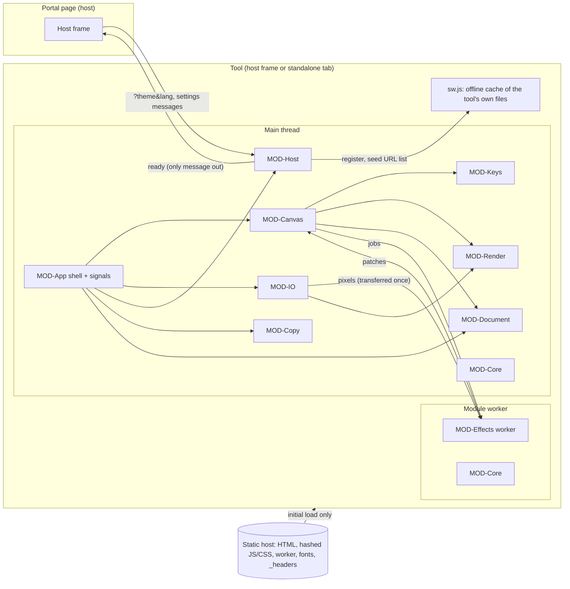
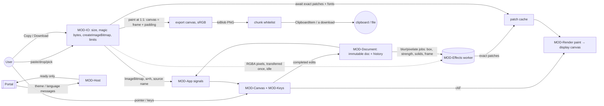

# Architecture

Status: accepted by the owner (2026-11-02; stack approved, D-022…D-025). Decisions: ADR-0001 …
ADR-0015. Modules: `modules/`. Dependencies: `dependencies.md`. Platform details:
`platform-mapping.md`. Source proposal: `.build-my-app/reports/architecture-proposal.md`.

## Summary
A static single-page web app served at its own address, embedded by the TaroKit portal in a
sandboxed frame and fully usable standalone (PRN-05, RULE-16). It is built like its siblings:
**Preact 10 + @preact/signals** (ADR-0002), **TypeScript 6 + Vite 8 + pnpm** with a lint ban on
network/storage APIs and lint-enforced module boundaries (ADR-0003), **plain CSS from the portal's
design tokens**, inlined icons and self-hosted Manrope / JetBrains Mono with Latin + Vietnamese
subsets (ADR-0013, ADR-0015), **Cloudflare static assets** behind a strict CSP with
`connect-src 'none'` and `frame-ancestors <hosts>` (ADR-0010), a hand-written **offline service
worker** (ADR-0011), and **Vitest, fast-check, Playwright (Chromium + WebKit), axe and Lighthouse
CI**, with no code-host workflows (ADR-0012, ADR-0014). What is new is our own code with **no new
runtime dependency**: a Canvas 2D scene renderer with one `paint()` for screen and export
(ADR-0004); `createImageBitmap` decoding into sRGB (ADR-0005); exact integer blur and pixelate
computed in a worker (ADR-0006); `toBlob` PNG plus a chunk whitelist, `ClipboardItem` with a
promised blob (ADR-0007); snapshot undo over an immutable document (ADR-0008); canvas text edited
through a transparent text field (ADR-0009). **No lazy chunks**: NFR-01 forbids fetching anything on
first use, so everything loads at startup.

## Assumptions
- A1. "50 MB" = 50,000,000 bytes (suite convention).
- A2. The portal applied the frame-grant change request (D-006) in taro-kit commit 4c4ae94
  (2026-11-04; its D-070, D-071): this tool's catalog entry declares `downloads`, `clipboard-write`,
  `popups`, `dialogs` and `file-pick`, which give `sandbox="allow-scripts allow-same-origin allow-forms
  allow-downloads allow-popups allow-popups-to-escape-sandbox allow-modals"`, `allow="clipboard-write"`
  and `referrerpolicy="strict-origin"`. The portal moves focus into the frame on the first ready only,
  and only while focus is still on its tool header (the portal's focus-on-ready rule). The tool contract asks for `blob:`
  downloads. The spec fallbacks (F-015.R7) still cover a host without the grants.
- A3. Production address `https://image-annotator.tarokit.app`, embedded by `https://tarokit.app`.
- A4. Text line height = 1.25 × text size, canvas text weight 600 (approved designs).
- A5. At zoom ≥ 200 % the image is drawn without smoothing on screen so pixel edges are crisp for
  precise redaction; the export is unaffected (INV-05).
- A6. Reference machine and reference images as defined in `50-quality/nfr.md`. NFR-04's 1 GB is
  the tool's page + worker footprint after GC in the Chromium-based engine; other engines are
  measured and recorded.
- A7. A "character" in RULE-08's 2,000 limit is a Unicode code point (ADR-0009).
- A8. Runtime targets below come from the NFRs; measured values come from the spikes, whose
  results are recorded against the pending conditions of ADR-0004/0005/0006/0007/0009.

## System context

After load, no arrow leaves the tool except the single ready signal and the browser's own
service-worker install/update fetches of the tool's own files (INV-04, NFR-01; enforced by CSP
`connect-src 'none'`, the lint ban, and the e2e request log).

## Modules
| Module | Thread | Responsibility (short) | Main features / rules |
|---|---|---|---|
| MOD-Core | any (pure) | Domain types; limits and scale-down; size tables; geometry + hit-testing; constraints; numbering; zoom steps; **frame/padding/canvas maths (D-020)**; file names; redaction count; magic bytes; PNG chunk whitelist | F-002…F-011 logic; RULE-01/02/04/05/06/07/12/13/14/15/20; INV-02, INV-05 |
| MOD-Document | main (pure) | Immutable document, edit operations, snapshot history with coalescing, change epoch → unexported | F-008, F-009, F-014 (state); RULE-11, RULE-18 |
| MOD-Render | main | `paint()`: background → image clipped to the frame → annotations and patches → clip to the canvas; crop view | F-003…F-007 visuals, F-010.R2, F-011; NFR-08; INV-02, INV-05 |
| MOD-Effects | worker + main client | Reference blur/pixelate, image pixels, patch cache, live approximation, job ids | F-007; RULE-10; NFR-02 |
| MOD-Canvas | main | View, display canvas, rAF, pointer/touch tool machine, handles, crop UI, text overlay, accessible region, bottom inset (D-019) | F-002…F-008, F-010; NFR-02, NFR-06, NFR-07 |
| MOD-Keys | main (pure core) | RULE-19 map: event + focus scope → action, keep-from-browser | F-013; RULE-19 |
| MOD-IO | main | Paste/drop/pick, checks, decode, scale-down; export pipeline; `beforeunload` | F-001, F-012, F-014.R1; RULE-01/02/03/15; INV-02/03/04; NFR-03 |
| MOD-App | main | Shell and components (incl. narrow summary bar + sheet, D-019; canvas size in the status bar, D-017), signals, commands, live regions | SCR-Annotator, F-016; NFR-06, NFR-07 |
| MOD-Host | boot + main + sw.js | Theme/language, origin-checked messages, single ready signal, SW registration + seeding | F-015, F-017, F-018; RULE-16/17; NFR-09 |
| MOD-Copy | main + build | Generated catalog, active language, number/plural formatting | copy.md; F-018 |
| MOD-Build | build | Codegen, headers, size/license/dist gates, release build, deploy config | NFR-01, NFR-05, NFR-09 |

**Dependency rule (lint-enforced import boundaries):** MOD-Core, MOD-Document and the pure core of
MOD-Keys import no DOM code; MOD-Document imports only MOD-Core; the effects worker imports only
MOD-Core; MOD-Render imports only MOD-Core and never reads language, theme or view state beyond the
transform it is given (INV-05; F-018.AC5 byte-identical exports); MOD-Copy is a dependency-free
leaf any UI module may import; only MOD-Host calls `postMessage` on the parent or touches the
service worker; only MOD-IO touches the clipboard, file input, downloads and `beforeunload`; only
MOD-App composes the others.

## Canvas maths (D-020)
The frame is a rectangle of the image (RULE-13). The canvas is the frame plus padding of
0 / 0.03 / 0.06 / 0.12 × the frame's longer side on every side (RULE-14), and is what is exported
(RULE-15) and what Fit shows outside the crop tool (RULE-12). A padding size is offered only if the
canvas stays within RULE-02; a frame change that would exceed it steps the padding down to the
largest size that fits, in the same undo step (F-011.R6). All of this is in MOD-Core; MOD-Render
clips image pixels to the frame and annotations to the canvas; the crop view shows the whole image,
dimmed outside the frame, without padding (F-010.R2). Blur and pixelate read only frame pixels and
show the background where their box leaves the frame (RULE-10, ADR-0006).

## Data flow


### Load (F-001)
`File.size` → magic bytes → decode → limits (scale-down offer in CMP-ConfirmDialog) → only then,
if the session is unexported, the replace confirmation (F-001.R7) → new session: empty history,
frame = whole image, padding none, current styles kept (ENT-Session), fitted view (F-002.R1). The
previous `ImageBitmap` is closed and the worker drops its pixels (NFR-04). In idle time the new
pixels are read once and transferred to the worker. Any refusal leaves the session unchanged.

### Draw and edit (F-003 … F-011)
Pointer and key input runs through MOD-Canvas's tool machine and MOD-Keys. While dragging, a
mutable controller holds the preview and requests a frame; MOD-Render paints document + preview.
On release, MOD-Canvas applies one operation to MOD-Document (one undo step, RULE-11), which
updates the signals; the chrome re-renders from them and the canvas repaints on the next frame.

### Blur and pixelate (F-007, ADR-0006)
Each blur/pixelate redaction has a patch keyed on its box, kind, strength, the solids it depends
on, and the frame. A missing patch is a job for the worker (latest wins); meanwhile, and during a
drag, the screen draws the approximation. Exact patches arrive within a few frames and always
after release; the export waits for all of them.

### Export (F-012, ADR-0007)
In the click/keydown task: create the `ClipboardItem` with a promise (copy) or start the download
path → await exact patches and fonts → paint at 1:1 over the canvas → `toBlob` → chunk whitelist →
clipboard write or `<a download>`. Success → MOD-Document records the export epoch (RULE-18), and
MOD-App announces the result with the redaction count (RULE-20). Failure → COPY-error.clipboard
(with download) or COPY-error.export_failed; the session stays unexported.

### Host and offline
An inline CSP-hashed boot script sets the theme and page language before first paint; MOD-Host
accepts only allow-listed, parent-sourced theme and language messages and posts exactly one ready
signal (RULE-16). After first render it registers `sw.js`; once fonts and the worker have loaded it
seeds every same-origin URL the page used; later openings serve the page network-first and hashed
assets cache-first, adopting a new version only on a later open (ADR-0011, F-017).

## Security headers (generated, ADR-0010, ADR-0025)
```
Content-Security-Policy: default-src 'none'; script-src 'self' '<boot-hash>'; style-src 'self';
  img-src 'self'; font-src 'self'; worker-src 'self'; connect-src 'none'; manifest-src 'none';
  frame-src 'none'; object-src 'none'; base-uri 'none'; form-action 'none';
  frame-ancestors https://tarokit.app            # HOST_ORIGINS; empty → 'none' (RULE-16, NFR-09)
Permissions-Policy: clipboard-write=(self), clipboard-read=(), camera=(), microphone=(), geolocation=(), …
Referrer-Policy: no-referrer · X-Content-Type-Options: nosniff · Cross-Origin-Opener-Policy: same-origin
Strict-Transport-Security: max-age=31536000; includeSubDomains · Cache-Control: no-cache (/assets/* immutable)
/sw.js → Content-Security-Policy: default-src 'none'; connect-src 'self'; worker-src 'self'
```
No relaxation is needed for decoding a `File`, drawing on canvases or downloading through `blob:`.
No `'wasm-unsafe-eval'`. `img-src blob:` only if SP-decode selects the `` fallback (a new ADR).

## Budgets and baselines

### Startup (NFR-05: interactive ≤ 1.5 s cold at 10 Mbit/s & 40 ms RTT; ≤ 0.5 s cached)
Everything is on the critical path (no lazy chunks). Enforced by `check:size` and Lighthouse CI with
matched throttling (ADR-0012).

| Item (compressed) | Budget |
|---|---|
| HTML (incl. inline boot script, inline SVG icons) | ≤ 12 KB |
| CSS (tokens + base + components) | ≤ 18 KB |
| JS main: Preact + signals, app, render, canvas, keys, IO, document, core, copy, host | ≤ 80 KB |
| Effects worker (MOD-Effects + MOD-Core) | ≤ 8 KB |
| Fonts (Manrope + JetBrains Mono variable WOFF2, Latin + Vietnamese) | ≤ 90 KB |
| **Total initial transfer** | **≤ 210 KB** |

At 10 Mbit/s that is ≈ 170 ms of transfer plus ~4 round trips.

### Runtime targets (spike pass criteria derive from these)
| Measure | Target | Source |
|---|---|---|
| Repaint while drawing/moving, 14.7 MP, 100 annotations incl. 10 blur/pixelate | 60 fps; `paint()` ≤ 8 ms/frame | NFR-02, SP-engine |
| Other input feedback | ≤ 100 ms; progress after 0.5 s | NFR-02 |
| Exact blur patch | ≤ 40 ms per MP in the worker; ≤ 250 ms after release for a 2000 × 1200 box | NFR-02, SP-blur |
| Open (paste/drop/file) | 14.7 MP ≤ 1 s (decode ≤ 600 ms); 5.2 MP ≤ 0.5 s | NFR-03, SP-decode |
| Export (copy/download) | 14.7 MP ≤ 1.5 s; 5.2 MP ≤ 0.5 s | NFR-03, SP-png-export |
| Memory, image at the RULE-02 limit + 200 annotations | < 1 GB; replaced image released | NFR-04, SP-large-image |
| Export fidelity | positions ≤ 1 px, text ≤ 2 px; blur/pixelate ±1 per channel vs ADR-0006 | NFR-08 |
| Requests after load | only the tool's own files into the offline cache | NFR-01 |

### Memory at the RULE-02 limit (16.7 MP, ≈ 67 MB per RGBA copy)
`ImageBitmap` (≈ 67 MB) on the main thread; one RGBA copy in the worker (≈ 67 MB); blur working
buffers are two 8-bit buffers of the read window (≤ 134 MB transient for a frame-sized box); the
patch cache is bounded (LRU, ≤ 256 MB); the display canvas is viewport × DPR ≤ 2 (≤ ~60 MB); the
export canvas plus the PNG blob exist only during export (≤ ~130 MB). History holds references,
not pixels. SP-large-image (ADR-0022) measured up to 890 MB on WebKit; iPadOS limits and GPU Chromium drag fps are QA checks.

## Risks (ranked) and how they are retired
1. **M-1 size** — 18 features including every redaction kind (D-001). Spikes first, then P0
   features in order.
2. **Live blur at 14.7 MP** — SP-blur; WebGL of the same definition as escape hatch (ADR-0006).
3. **WebKit canvas memory and tablet limits** — SP-large-image.
4. **Text caret drift and input methods** — SP-text; visible field fallback (ADR-0009).
5. **Clipboard in a frame on WebKit and the portal grants** — SP-host; fallbacks in F-015.R7.
6. **Firefox checked manually only** — ADR-0014 release checks.
7. **Engine encoders adding chunks later** — the whitelist plus a chunk-list e2e assertion.

## Spikes
Each confirms the pending condition of one or more ADRs. ⛔ = blocks the build of what depends on it.

| Order | ID | Question | Pass criteria | Confirms | Box |
|---|---|---|---|---|---|
| 1 ⛔ | SP-engine | Can the own renderer hit-test, move, resize and show handles for rectangle, ellipse, arrow and stroke, with snapshot undo, within budget? | 4 kinds draw/select/move/resize/undo; 100 annotations on 14.7 MP repaint ≤ 8 ms/frame (Chromium, WebKit); hit tolerance works at 10 % and 800 %; ≤ 25 KB gzip. Fail → Konva (DEP-26) | ADR-0004, ADR-0008 | 2 d |
| 1 ⛔ | SP-blur | Is the reference strong enough, and can it stay live? | 12–16 px text unreadable at S on 2880 × 1800; worker blur ≤ 40 ms/MP; 10 blur redactions + dragging a 2000 × 1200 box hold 60 fps with the approximation, exact ≤ 250 ms after release; fast-check equals the slow reference. Fail → WebGL | ADR-0006 | 1.5 d |
| 2 ⛔ | SP-png-export | Chunk whitelist and timing on every engine; does it paste into apps? | Chunks = IHDR/IDAT/IEND on Chromium, WebKit, Firefox (manual); 14.7 MP ≤ 1.5 s, 5.2 MP ≤ 0.5 s; pastes into common chat, code-hosting and document apps | ADR-0007 | 0.5 d |
| 2 ⛔ | SP-decode | Orientation, wide gamut and formats via `createImageBitmap` | EXIF 1–8 upright with swapped sizes; P3/Adobe RGB JPEG+PNG look the same on screen and in export; GIF first frame; AVIF where supported; HEIC refused; 14.7 MP decode ≤ 600 ms. Fail → `` + `img-src blob:` | ADR-0005 | 0.5 d |
| 3 | SP-large-image (passed with adaptation, ADR-0022) | Memory and canvases at 4096², 16384 × 1024, iPad | < 1 GB with 200 annotations; replacing frees memory; export canvas at the limit on WebKit and iPadOS; display canvas keeps 60 fps | NFR-04; ADR-0005, ADR-0007 | 1 d |
| 4 | SP-text | Transparent text field over canvas glyphs | Drift < 2 px at 25–800 % with Vietnamese (NFD + NFC), Chromium + WebKit; composition works; export matches 100 % view within 2 px | ADR-0009 | 1 d |
| 5 | SP-host | Frame behaviour under production-like headers via the stub host | Paste with and without host focus; Mod+C promised `ClipboardItem` in WebKit; refusal path without `clipboard-write`; downloads and leave-page dialog as F-015 says; `frame-ancestors` refuses another origin; page `fetch` refused; offline after one visit | ADR-0007, ADR-0010, ADR-0011 | 1 d |

Spikes 1 and 2 gate the stack's risky parts (≈ 4.5 d). Spikes 3–5 shape the implementation and
can overlap the build. Reports go to `.build-my-app/reports/`.

## Environments
Local dev, local release preview (the exact `dist/`, e2e and the stub host), and production on
Cloudflare static assets at `image-annotator.tarokit.app`; no staging in M-1; nothing provisioned
before phase 7 (ADR-0010).
